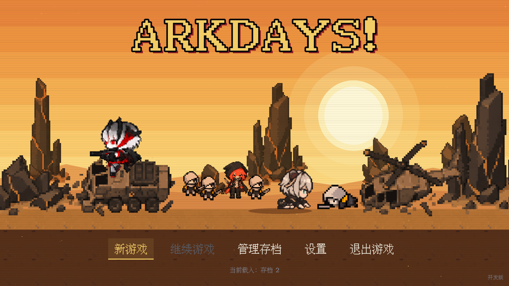
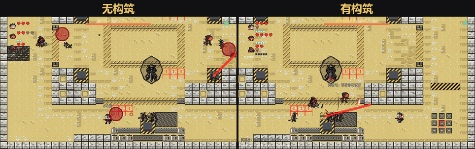
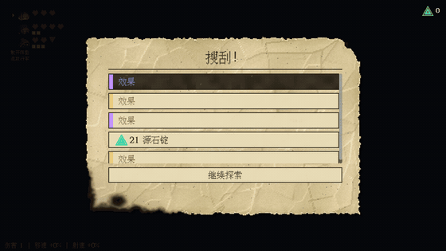
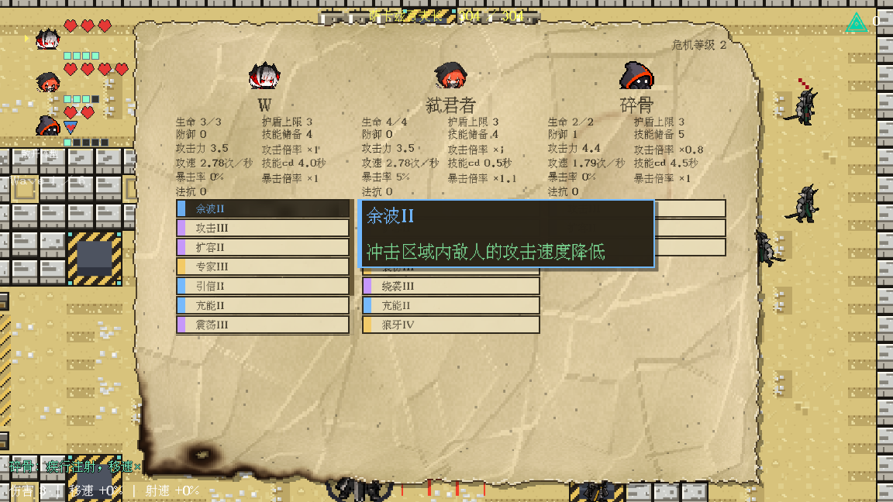
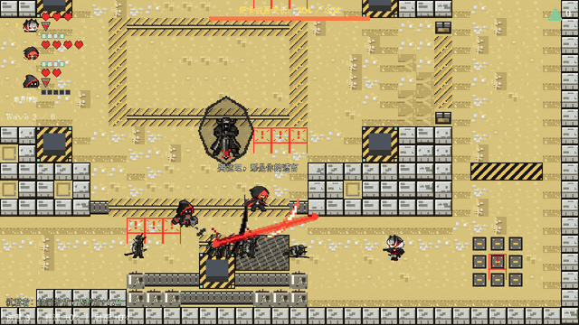
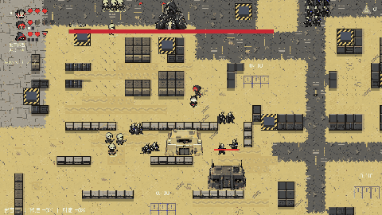
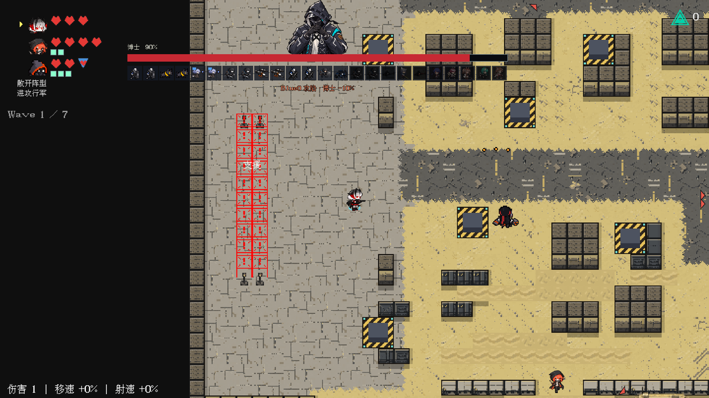
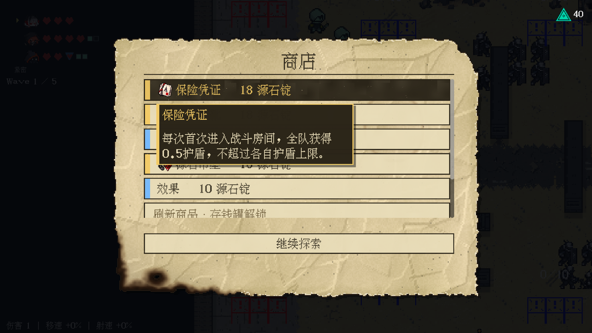

# ARKdays!

**八方向像素射击 × 三人小队 × Roguelite 构筑**：一款使用 Godot 4 独立开发的《明日方舟》同人二创游戏，不用于商业用途。项目最初受 B 站 UP 主 Voidmatrix 老师的教程《从零开始的Godot游戏开发》启发与引导。



> 这是项目的展示仓库，只包含介绍、实机画面和代码节选。完整工程保存在私有仓库：游戏含同人素材，部分音乐的对外许可尚未明确，所以不公开源码和素材文件。

*An independently developed Arknights fan game built with Godot 4: an eight-direction pixel shooter with squad AI, roguelite builds and a commander-style final boss. This repository only hosts the overview, gameplay footage and code excerpts.*

## 项目概览

| | |
|---|---|
| **类型** | 俯视角像素射击、三人小队、Roguelite |
| **引擎与语言** | Godot 4.7、GDScript，离线工具链用 Python |
| **开发方式** | 个人独立开发，使用 AI 工具辅助 |
| **流程** | 五层战役，第五层以博士关底收尾 |
| **内容规模** | 98 个角色效果系列（219 个等级）、66 件藏品（64 件启用） |
| **工程规模** | 227 个运行时脚本、约 5.2 万行 GDScript，197 个测试脚本 |
| **当前状态** | 开发中，流程已串通，自然游玩的平衡验收尚未完成 |

## 玩法

玩家同时操控一名队员，其余成员由 AI 协战，可以随时切换主控和阵型。每局在波次战斗、搜刮、商店和事件之间选路前进，用这一局拿到的效果和藏品组出自己的打法。

| 角色 | 作战方式 |
|---|---|
| **W** | 八方向远程射击，可放置小丑盒定时炸弹 |
| **弑君者** | 八向近战，靠翻滚穿过敌阵 |
| **碎骨** | 地面散射和大范围斩击，登上高台后切换为驻台火力 |

主控倒地时会转交给仍站立的队员，队友可以救援，全员倒地才结束本局。

### 构筑：效果之间互相放大

每局从搜刮和商店里挑选效果，效果可以跨角色联动。下面这套构筑里，W 的盒子爆炸负责破防和晕眩，弑君者的「狼牙」在破防叠满时触发处决，击杀后瞬移到下一个目标继续处决。

**同一房间、同一随机种子，AI 托管，左边无构筑，右边有构筑：**



两轮录制中，同样录制 35 秒，有构筑的队伍击杀 21 和 23 个敌人，无构筑两次都是 11 个。这里的构筑是录制时直接写入的演示预设，只有这两轮样本，只用来说明构筑对战局的影响，不代表平衡数据。

| 搜刮时挑选效果 | 按住 B 查看本局构筑 |
|---|---|
|  |  |



## 技术亮点

### 1. 分层决策的博士关底 AI

博士不是按脚本出招的 Boss，而是一个和玩家争夺地图的指挥官。它用费用账本在战场上空降部队，名册共 17 种单位、23 个槽位。



决策分成几层，各层职责独立：

```text
全局快照 → 战略态势 → 战术评分 → 配兵与落点 → 编队执行 → 战果回写士气
```

- **战略层**：在经营、防御、反攻、猎杀、决战五种态势之间切换。态势有最短维持时间和切换阈值（滞回），避免来回抖动；中央门告急时可以强制切换。
- **战术层**：二十余种候选战术按门的威胁、费用和近期损失评分，分差很小时用独立种子随机选择，让对局不至于完全可预测。
- **构筑画像**：根据玩家的效果和藏品估计威胁，并对配兵加减分，所以不同构筑会遇到不同的应对。
- **可测试**：账本和战术评估是不碰场景节点的纯逻辑，测试直接构造局面，核对选中的计划和落点。

代码节选：[`doctor_strategy.gd`](code-samples/doctor_strategy.gd)、[`doctor_tactics.gd`](code-samples/doctor_tactics.gd)



### 2. 数据驱动的 Roguelite 构筑系统

- **单一数据源**：效果和藏品用 Markdown 表维护，由生成器输出运行时 JSON，`--check` 校验两者一致，运行时 JSON 不手改。
- **纯逻辑抽取引擎**：输入一份请求，输出候选效果，固定种子可以反复驱动，便于测试。
- **抽取规则**：覆盖前置、互斥、等级上限和稀有度概率；连续两池没有出现的角色会得到轻微补偿（最高 1.3 倍），避免某个角色长期抽不到。
- **状态分层**：本局构筑、永久档案和房间检查点分开维护，已生成的奖励候选会缓存，返回或重进不会重抽。

代码节选：[`effect_pool_engine.gd`](code-samples/effect_pool_engine.gd)



### 3. 种子驱动的路线生成

地图由手工搭建，随机性来自路线层：每局按种子生成选路候选，并保证路线满足配额。以第五层为例，共十一房，每个出口给 2 到 3 个候选，路线上至少有 1 间商店、1 间奖励房、2 间事件房。

- 候选只由种子和已走房间决定，重试和读档后结果不变。
- 路线快照带版本号，规则调整后旧存档仍按旧规则重放。
- 回归测试随机走 1500 条路线，核对保底、候选数量、不重复和重放结果。

代码节选：[`chapter5_route.gd`](code-samples/chapter5_route.gd)

### 4. 路线网络导航和性能排查

大规模编队改为沿场景里的折线路网行军：折线放宽成走廊，路网最短路树按需建立并缓存，选路只比较起止两段的端点组合。折线由离线工具根据可走格生成，第四、五层的门战房（黑蓑房除外）都接入了这套路网。

这里有一次值得记录的排查。回归测试要求路网把逐人网格寻路次数压到旧方案的四分之一以内，但在约 50 到 75 个单位的压力测试中，帧耗时和旧导航持平，说明寻路并不是卡顿的来源。真正的百毫秒级卡顿来自编制首次出场时的资源加载。改为换房黑屏时按层预载后，最慢帧降到约 15 到 30 毫秒。

代码节选：[`route_network.gd`](code-samples/route_network.gd)

### 5. 自动化验证

- 197 个测试脚本按系统分组，由统一入口运行，每个用例独立启动 Godot 进程。缺少脚本、超时或缺少完成证据都算失败。
- 统一检查入口覆盖资源导入、全量脚本编译、主场景冒烟、注释规范和文档链接。
- AI 托管可以跑真实战斗，用于观察队友 AI 和战斗节奏。本页的战斗 GIF 也是用它录制的，画面里的队伍都由 AI 操作。

## 我负责的工作

项目从策划到实现全部由我一人完成，没有其他协作者，包括：

- **玩法和系统设计**：战斗、角色、效果和藏品、路线、经济、Boss 机制。
- **架构和实现**：Godot 工程结构、小队 AI、博士 AI、存档、数据管线。
- **关卡和内容**：地图搭建、波次配置、剧情和事件。
- **工具和验证**：Python 素材与数据工具、自动化测试、问题排查和最终验收。

**AI 工具的使用：** 我熟练使用 AI 工具辅助开发。代码实现中使用了 Claude、Codex 等 AI 编程工具，部分美术素材也由 AI 图像工具生成后再做像素化处理。需求拆解、方案取舍、效果判断和最终验收由我负责。

## 技术栈

- **引擎**：Godot 4.7、GDScript
- **工具链**：Python（素材打包、配置生成、路网生成、资源审计）
- **工程实践**：Git、Conventional Commits、提交钩子、自动化回归测试
- **AI 工具**：Claude、Codex、AI 图像生成

## 版权和致谢

- 本项目是《明日方舟》同人二创，非官方作品，不用于商业用途。《明日方舟》相关角色、敌人和素材的权利归原权利人所有。
- 感谢 B 站 UP 主 Voidmatrix 老师：本项目最初受其教程项目《从零开始的Godot游戏开发》启发与引导。
- 本仓库的代码节选仅供阅读和交流，不授予开源许可。
